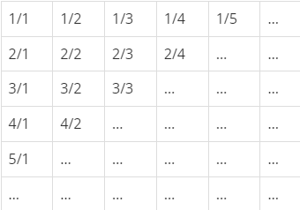

## 알 수 있는 점

- 무한히 큰 배열에 분수가 반복이 된다.
- 배열의 규칙은 가로를 기준으로 분모는 1부터 계속 커진다.
- 분자는 세로를 기준으로 1부터 계속 커진다.
- 1/1 → 1/2 → 2/1 → 3/1 → 2/2 → … 과 같은 지그재그 순서로 차례대로 1번, 2번, 3번, 4번, 5번, … 분수라고 하자.

## 가설

- N번째 줄에 있는 분수는 분모, 분자의 크기가 N보다 작다.
- N번째 줄에 있는 경우는 1부터 N까지의 더한 수 범위 내에 존재한다.
- 내 생각에는 N을 가지고서 N이 지그재그로 몇번째 줄에 존재하는지 구해야 할 거 같다.
- 1 + 2 + 3 + 4 + 5 ( 11 ~ 15)
- 짝수면, 지그재그가 아래에서 위로, 홀수면 지그재가 위에서 아래로 흘러간다.

## 풀이

## 관건

- 브르투포스 다 찾기에는 무리가 있다.
- 수학적 규칙을 찾아야 한다.
