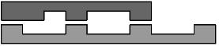
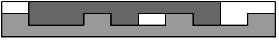

[https://www.acmicpc.net/problem/1195](https://www.acmicpc.net/problem/1195)

- 기어가 ‘이’와 ‘홈’이 있는데 상측 기어와 하측 기어가 서술 맞물리는데 그 길이가 최소한의 길이가 되는 값을 출력해야 한다.
- ‘1’이 홈, ‘2’가 이 이다.
- 부르트포싱을 이용하여 구해야 하는데 상측 기어와  하측 기어를 전체 탐색하여 위 아래로 비교해본 후, 더해 값이 3이면 기어가 맞물리는 거고, 더했을때 2가 나오면, 이밖에 없는 것이고 4가 나오면 홈이 서로 맞닿아 맞물리지 않는다.

## 판정

- 중요한 점은 기어의 전체 길이가 최소 거리가 나와야 한다는 점이다.
- 따라서 맞물리거나, 이와 이끼리 닿는 것은 상관없다. → 단, 홈과 홈끼리 닿으면 기어가 맞물리지 않기 때문에 이 경우는 안된다.
- 기어와 기어끼리 맞물리지 않는 경우도 생각해야 한다.

## 전 구현 방식





- 처음에는 기어의 최소길이를 구하는 방법을 두 파트로 나누어 생각했다.
- 길이가 더 긴 기어를 gear1, 작은 기어를 gear2로  정의한 뒤, gear1을 기준으로, gear2를 왼쪽방향으로 gear2의 마지막 인덱스와 gear1의 첫번째 인덱스의 위치를 같게 정의 시켜서 왼쪽에서 오른쪽까지 한칸한칸씩 옮겼다.
- 옮겨가면서 gear2의 첫번째 인덱스가 gear1의 마지막 인덱스가 만나면 종료된다.
- 이와 마찬가지로 오른쪽에서 왼쪽도 같은 방식으로 진행된다.
- gear1과 gear2와 비교하면서 같은 위치에서의 기어의 숫자를 더했을때 3보다 크면, 홈과 홈이 만나는 것이기 때문에 기어가 맞물리지 않는 경우이므로 break를 걸고, gear1의 위치를 한칸씩 옮겼다.
- 무조건 맞물린다고 하여, 최소길이라는 보장이 없기 때문에 위치를 옮기면서 기어가 맞물리지 않는 경우를 변수 후보군에 저장시킨다.
- 후보군 중에서 가장 작은 숫자를 출력시켜 최소한의 길이를 구한다.

## 현 구현 방식

- gear1과 gear2에서 기어를 옮기는 방식에서 왼쪽에서 오른쪽으로 도는 방식, 오른쪽에서 왼쪽으로 도는 방식으로 나누어 여기서 나온 최소 길이의 후보군을 따로 저장시켜 최소한의 길이를 얻는 방식이었다.
- 하지만 step을 굳이 따로 나눌 필요가 있나 생각이 들었고, for문을 낭비한다는 생각이 들었다.
- gear1을 고정시키고 gear2를 옮기는 방식과 달리, gear2를 고정시키고, gear1의 마지막 인덱스를 gear2의 첫번쨰 인덱스와 같은 위치시켜, gear1을 첫번째 인덱스까지 돌려, 왼쪽에서 오른쪽까지 한번에 돌리는 방식으로 변경했다.
- 이러한 방식으로 돌리면, 한가지 예외상황이 생기는데, 기어가 겹치지 않는 경우이다.
- 기어가 모두 홈일 경우가 생기기 때문에, 이는, 후보군을 모두 저장하는 변수에서 사이즈가 0 이면, gear1의 길이와 gear2의 길이를 더하여 모두 만나지 않는 예외사항까지 처리했다.
- gear1의 길이는 gear2의 길이보다 길이가 더 길도록 설정했다.(길이가 같은 경우는 상관없음)
- gear1이 gear2를 도는 전체 횟수는 gear1.length() + gear2.length() - 1이다.
- 이를 바탕으로, gear1.length()의 길이보다 크고 , gear1.length()의 길이보다 크고 작고를 기준으로 for문이 다르게 돌아간다.
- 전체를 돌면서 두번째 for문은 현재 gear1과 gear2가 얼마나 맞물려 있는지의 횟수만큼 돌아간다.
- 이것이 gear1.length()를 기준으로 크고 작고할때, 기준이 달라진다.
- 먼저 gear1.length()보다 작을때에는 for문 돌리는 횟수의 기준이 크게 두 가지로 나뉜다.
- 처음에는 전체 for문을 도는 횟수인 i번을 기준으로 gear2가 gear1의 인덱스 0번을 기준으로 공백이 있냐 없느냐에 따른 기준에 따라 나뉘게 된다.

## 코드

```cpp
#include <iostream>
#include <string>
#include <vector>
#include <algorithm>
using namespace std;

int main() {
    string gear1;
    string gear2;
    string save;
    int count = 0;;
    int m = 0;
    vector<int> n;
    cin >> gear1;
    cin >> gear2;

    if (gear1.length() < gear2.length()) {
        save = gear1;
        gear1 = gear2;
        gear2 = save;
    } // gear1이 gear2보다 길이가 길도록 설정 -> 반복하기에 용이
    for (int i = 0; i < gear1.length() + gear2.length() - 1; i++) {
        //segfault 오류 -> 범위 잘못 설정
        count = 0;
        if (i > gear1.length() - 1) {
            for (int j = 0; j < gear2.length() - (i + 1 - gear1.length()); j++) {
                //gear1과 gear2가 겹치는 횟수
                if ((gear1[i + 1 - int(gear2.length() + j)] - '0') + (gear2[j] - '0') > 3) {
                    count = 99999;
                    break;
                } else {
                    count++;
                }
            }
        } else {
            if (i + 1 - int(gear2.length()) >= 0) {
                m = int(gear2.length());
            } else {
                m = i + 1;
            }
            for (int j = 0; j < m; j++) {
                //gear1과 gear2가 겹치는 횟수
                if ((gear1[i - j] - '0') + (gear2[int(gear2.length()) - j - 1] - '0') > 3) {
                    count = 99999;
                    break;
                } else {
                    count++;
                }
            }
        }
        if (count == m || count == gear2.length() - (i + 1 - gear1.length())) {
            //끝까지 했는지 횟수 검증
            if (i > int(gear2.length()) - 1) {
                if (count - 1 == gear2.length()) {
                    //gear2가 gear1 안에 있으면
                    n.push_back(gear1.length());
                } else {
                    n.push_back(gear1.length() + gear2.length() - count);
                }
            } else {
                //gear2의 길이만큼 반복할때까지는 밑의 식을 실행한다.
                n.push_back(gear2.length() + (gear1.length() - i) - 1);
            }
        }
    }

    if (n.size() == 0) {
        cout << gear1.length() + gear2.length() << endl;
    } else {
        cout << *min_element(n.begin(), n.end()) << endl;
    }

    return 0;
}

```

## 2025.11.24 - *오늘의 킥 -*

```cpp
#include <iostream>
#include <string>
#include <vector>
#include <algorithm>
using namespace std;

int main() {
    string gear1;
    string gear2;
    string save;
    int count = 0;;
    int m = 0;
    vector<int> n;
    cin >> gear1;
    cin >> gear2;

    if (gear1.length() < gear2.length()) {
        save = gear1;
        gear1 = gear2;
        gear2 = save;
    } // gear1이 gear2보다 길이가 길도록 설정 -> 반복하기에 용이
    for (int i = 0; i < gear1.length() + gear2.length() - 1; i++) {
        //segfault 오류 -> 범위 잘못 설정
        count = 0;
        if (i > gear1.length() - 1) {
            for (int j = 0; j < gear2.length() - (i + 1 - gear1.length()); j++) {
                //gear1과 gear2가 겹치는 횟수
                if ((gear1[i + 1 - int(gear2.length()) + j] - '0') + (gear2[j] - '0') > 3) {
                    count = 99999;
                    break;
                } else {
                    count++;
                }
            }
        } else {
            if (i + 1 - int(gear2.length()) >= 0) {
                m = int(gear2.length());
            } else {
                m = i + 1;
            }
            for (int j = 0; j < m; j++) {
                //gear1과 gear2가 겹치는 횟수
                if ((gear1[i - j] - '0') + (gear2[int(gear2.length()) - j - 1] - '0') > 3) {
                    count = 99999;
                    break;
                } else {
                    count++;
                }
            }
        }
        if (count == m || count == gear2.length() - (i + 1 - gear1.length())) {
            //끝까지 했는지 횟수 검증
            if (i > int(gear2.length()) - 1) {
                if (count - 1 == gear2.length()) {
                    //gear2가 gear1 안에 있으면
                    n.push_back(gear1.length());
                } else {
                    n.push_back(gear1.length() + gear2.length() - count);
                }
            } else {
                //gear2의 길이만큼 반복할때까지는 밑의 식을 실행한다.
                n.push_back(gear2.length() + (gear1.length() - i) - 1);
            }
        }
    }

    if (n.size() == 0) {
        cout << gear1.length() + gear2.length() << endl;
    } else {
        cout << *min_element(n.begin(), n.end()) << endl;
    }

    return 0;
}

```

```cpp
#include <iostream>
#include <string>
#include <vector>
#include <algorithm>
using namespace std;

int main() {
    string gear1;
    string gear2;
    string save;
    int count = 0;;
    int m = 0;
    vector<int> n;
    cin >> gear1;
    cin >> gear2;

    if (gear1.length() < gear2.length()) {
        save = gear1;
        gear1 = gear2;
        gear2 = save;
    } // gear1이 gear2보다 길이가 길도록 설정 -> 반복하기에 용이
    for (int i = 0; i < gear1.length() + gear2.length() - 1; i++) {
        //segfault 오류 -> 범위 잘못 설정
        count = 0;
        if (i > gear1.length() - 1) {
            for (int j = 0; j < gear2.length() - (i + 1 - gear1.length()); j++) {
                //gear1과 gear2가 겹치는 횟수
                if ((gear1[i + 1 - int(gear2.length() + j)] - '0') 
                // int의 가로 때문에 계속 정답이 안나왔던거임;; 뺄셈 교환법칙이 성립이 안되서
                //여태껏 안됐었던 거누 -> 아니 이것땜에 개삽질했네 ㅋㅋㅋㅋ;;
                + (gear2[j] - '0') > 3) {
                    count = 99999;
                    break;
                } else {
                    count++;
                }
            }
        } else {
            if (i + 1 - int(gear2.length()) >= 0) {
                m = int(gear2.length());
            } else {
                m = i + 1;
            }
            for (int j = 0; j < m; j++) {
                //gear1과 gear2가 겹치는 횟수
                if ((gear1[i - j] - '0') + (gear2[int(gear2.length()) - j - 1] - '0') > 3) {
                    count = 99999;
                    break;
                } else {
                    count++;
                }
            }
        }
        if (count == m || count == gear2.length() - (i + 1 - gear1.length())) {
            //끝까지 했는지 횟수 검증
            if (i > int(gear2.length()) - 1) {
                if (count - 1 == gear2.length()) {
                    //gear2가 gear1 안에 있으면
                    n.push_back(gear1.length());
                } else {
                    n.push_back(gear1.length() + gear2.length() - count);
                }
            } else {
                //gear2의 길이만큼 반복할때까지는 밑의 식을 실행한다.
                n.push_back(gear2.length() + (gear1.length() - i) - 1);
            }
        }
    }

    if (n.size() == 0) {
        cout << gear1.length() + gear2.length() << endl;
    } else {
        cout << *min_element(n.begin(), n.end()) << endl;
    }

    return 0;
}

```
