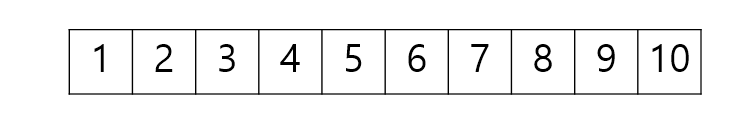
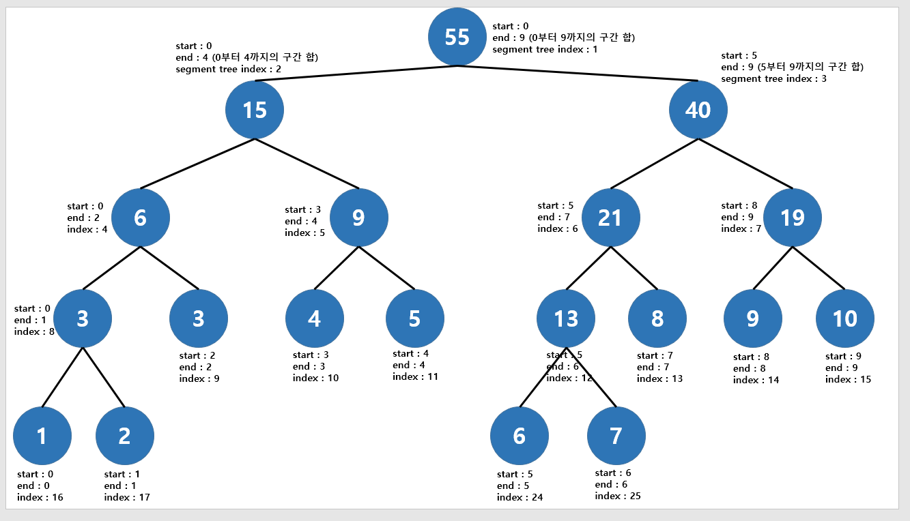

## 세그먼트 트리(Segment Tree)

- 시간복잡도 : `O(logN)`
- 여러 개의 데이터가 존재할 때 특정 구간의 합(최솟값, 최댓값, 곱 등)을 구하는 데 사용하는 자료구조
- 트리 종류 중에 하나로 이진 트리의 형태이며, 특정 구간의 합을 가장 빠르게 구할 수 있다는 장점이 있다. (`O(logN)`) → 그냥 일일이 찾아 더하면 O(N)이지만, 세그먼트 트리를 활용하면 시간복잡도를 줄일 수 있다.

### 세므먼트 트리 - 구간 합

- 세그먼트 트리의 크기는 배열(arr)의 개수가 N개일 때, N보다 큰 가장 가까운 N의 제곱수를 구한 뒤에 그것의 2배를 하여 미리 세그먼트 트리의 크기를 만들어놓어야 한다.
- 세그먼트 트리의 크기는 배열(arr)의 개수가 N개일 때, N보다 큰 가장 가까운 N의 제곱수를 구한 뒤에 그것의 2배를 하여 미리 세그먼트 트리의 크기를 만들어놓어야 한다.
- 만약 배열의 개수가 10개일 때, 가장 가까운의 N의 제곱수는 16이고, 16 X 2 = 32 → 총 32개의 트리를 만들어야 한다.
- 그림과 같이 배열이 1~10까지 존재한다고 가정한다.
- 0번째 노드는 전체 구간의 합이므로 1~10까지의 합은 55이다.
- 자식이 없는 놈들의 노드들은 배열의 원래 데이터 값을 가지고 있다.
- 세그먼트트리 구간합은 재귀함수로 짜기 용이하다.
