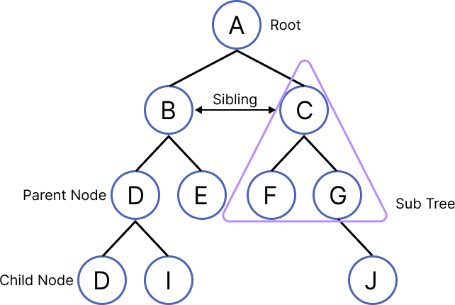

- 그래프(Graph)의 한 종류로, **계층적인 구조**를 나타내는 **비순환적인 연결 그래프**
- 트리는 하나의 루트(Root) 노드에서 시작하여 다양한 자식(Child) 노드들로 확장되는 구조를 가짐
- 각 노드는 하나의 부모(Parent) 노드와 연결되어 있음

## 구조

- 노드(Node) : 트리 구조를 이루는 모든 개별 데이터
- 루트(Root) : 트리 구조의 시작점이 되는 노드
- 부모 노드(Parent node) : 두 노드가 상하관계로 연결되어 있을 때 상대적으로 루트에서 가까운 노드
- 자식 노드(Child node) : 두 노드가 상하관계로 연결되어 있을 때 상대적으로 루트에서 먼 노드
- 리프(Leaf) : 트리 구조의 끝 지점이고, 자식 노드가 없는 노드

## 트리의 특징

- 계층 구조 : 트리는 하나의 루트 노드에서 시작하여 계층적인 구조를 형성
  - 각 노드는 부모-자식 관계를 가짐
  - 자식 노드들은 동일한 계층에 속함
- 방향성 : 트리는 방향 그래프의 한 형태로, 간선은 단향으로 표시
  - 각 노드는 자식 노드들을 가리키는 방향으로 연결
- 비순환성 : 트리는 순환 구조를 가지지 X
  - 즉, 어떤 노드에서 시작해도 동일한 노드로 되돌아갈 수 있는 순환 경로 존재하지 X
- 유일한 경로 : 루트 노드에서 어떤 노드까지의 경로는 유일
  - 트리 내에서는 어떤 노드도 다른 경로를 통해 도달 X

## 트리 종류

- 이진 트리(Binary Tree) : 각 노드가 최대 **두 개의 자식을 가질 수 있는 트리**
