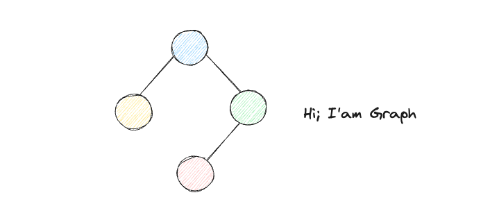
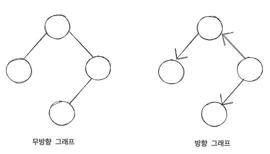
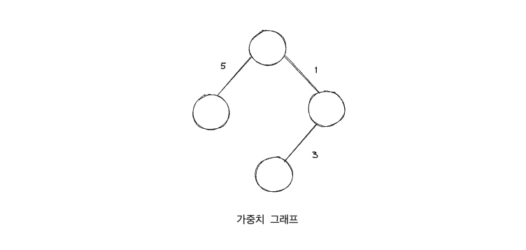
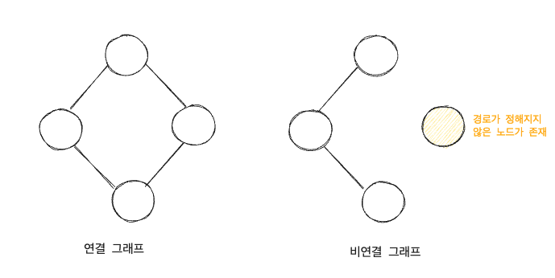
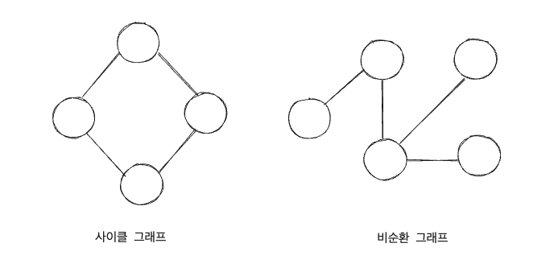
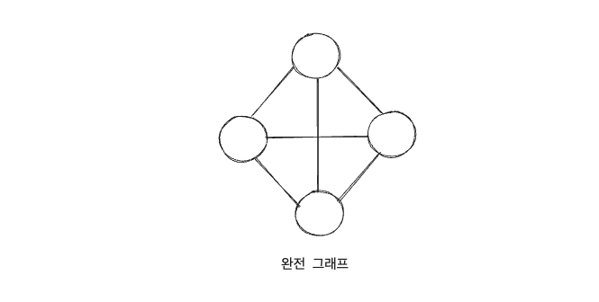

- 그래프는 여러 개의 점(노드 또는 정점)들이 선으로 연결된 구조를 나타내는 **수학적인 개념**
- 그래프는 다양한 현실 세계의 문제를 모델링하고 분석하는 데 사용된다.
- **정점(vertex, 꼭지점)** 또는 **노드(node)**는 그래프를 형성하는 기본 단위이다.
- 정점의 집합을 *V*, 간선의 집합을 *E*, 그래프를 *G*라고 했을 때 *G*=(*V*,*E*) 이다.

## 용어

- 노드(node) : 그래프에서 하나의 점
  - 노드는 데이터를 저장하는데 사용될 수 있다.
- 간선(Edge) : 그래프에서 노드와 노드를 연결하는 선
  - 간선은 노드 쌍 사이의 관계를 나타낸다.
- 인접(Adjacent) : 두 개의 노드가 간선으로 직접 연결되어 있는 상태
  - 인접한 노드는 서로 ‘이웃’이라고 함
- 차수(Degree) : 노드에 연결된 간선의 수
  - 무방향 그래프에서는 노드의 차수는 해당 노드와 인접한 노드의 수
- 경로(Path) : 그래프에서 노드들을 연결하는 간선의 순서를 나타내는 순서쌍
  - 경로의 길이는 경로에 속한 간선의 수
- 사이클(Cycle) : 그래프에서 동일한 노드로 되돌아오는 경로
  - 즉, 경로의 시작 노드와 끝 노드가 동일한 경우
- 가중치(Weight) : 가중치 그래프에서 간선에 할당된 값 또는 비용
  - 가중치는 간선의 특성을 나타내는데 사용

  

---

## 종류

---

### 무방향 그래프

- 간선의 방향의 유무에 따라 구분되는 그래프
- 관계가 없는 경우 무방향 그래프가 유용

### 방향 그래프

- 그래프에 가중치 또는 비용이 할당된 그래프
  - 네트워크 이론이나 신경망 이론에 활용되는 개념
- 정점간의 연결에 순서나 방향성이 존재하는 경우 방향 그래프가 유용

---

### 연결 그래프

- 모든 노드에 대해 경로가 존재하는 그래프

### 비연결 그래프

- 특정 노드에 대한 경로가 하나라도 존재하지 않는 그래프

---

### 사이클 그래프 & 비순환 그래프

---

### 완전 그래프

- 그래프의 모든 노드가 연결되어 있는 그래프

