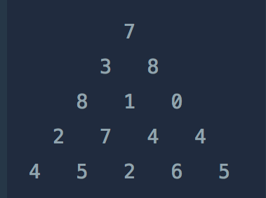

[https://school.programmers.co.kr/learn/courses/30/lessons/43105](https://school.programmers.co.kr/learn/courses/30/lessons/43105)

## 풀이



- 해당 문제는 삼각형의 맨 꼭대기에서 밑에까지 내려가서 갈림길마다 최대의 정수를 선택하여 최대로 더할 수 있는 최대값을 구하는 문제이다.
- 맨 밑의 두번째 삼각형 줄에서부터 시작하여 한 줄 아래의 삼각형 중에서 왼쪽, 오른쪽 중 큰 값을 구하여 해당 줄의 위치에서 자신의 값 + 더 큰 값을 더한다.
- 두번째 삼각형 줄에서 왼쪽 → 오른쪽으로 순회하면 결국에는 맨 꼭대기 위에는 가장 큰 값이 남게 된다.
- 따라서 맨 꼭대기 삼각형의 값이 최종 답이다.

## 코드

```python
def solution(triangle):
    for i in range(len(triangle)-2,-1,-1) :
        for k in range(0,len(triangle[i])) :
            triangle[i][k] += max(triangle[i+1][k], triangle[i+1][k+1])
    return triangle[0][0]
```
